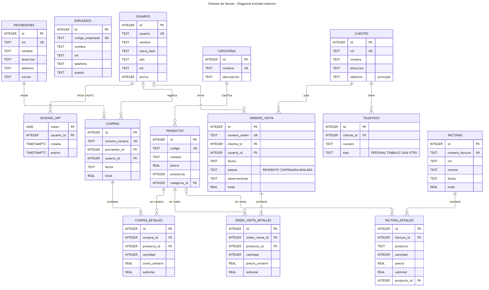
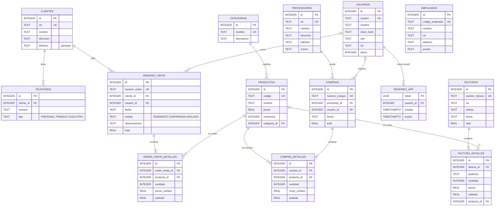

# Diagrama entidad-relación

El sistema tiene **13 tablas**. Funcionan igual en la base en la nube (**PostgreSQL en Supabase**, compartida con la app móvil) y en la base local SQLite (`datos/sistema_ventas.db`, cuando no hay configuración de nube). La nube tiene además `sesiones_app`, para los inicios de sesión del celular. `ConexionBD` crea las tablas al arrancar; en SQLite activa las llaves foráneas con `PRAGMA foreign_keys = ON`.

## Reglas de las llaves foráneas

| Relación | Al borrar el registro padre |
|---|---|
| `telefonos.cliente_id → clientes.id` | `CASCADE`: se borran los teléfonos con el cliente |
| `productos.categoria_id → categorias.id` | `SET NULL`: el producto queda sin categoría |
| `compras.proveedor_id → proveedores.id` | Se impide: no se borra un proveedor con compras |
| `compras.usuario_id → usuarios.id` | `SET NULL`: la compra se conserva sin usuario |
| `compra_detalles.compra_id → compras.id` | `CASCADE`: se borran los detalles con la compra |
| `compra_detalles.producto_id → productos.id` | Se impide: no se borra un producto con compras |
| `factura_detalles.factura_id → facturas.id` | `CASCADE`: se borran los detalles con la factura |
| `factura_detalles.producto_id → productos.id` | `SET NULL`: la factura conserva el nombre del producto |
| `sesiones_app.usuario_id → usuarios.id` | `CASCADE`: se cierran las sesiones móviles del usuario |
| `ordenes_venta.cliente_id → clientes.id` | Se impide: no se borra un cliente con órdenes de venta |
| `ordenes_venta.usuario_id → usuarios.id` | `SET NULL`: la orden se conserva sin usuario |
| `orden_venta_detalles.orden_venta_id → ordenes_venta.id` | `CASCADE`: se borran los detalles con la orden |
| `orden_venta_detalles.producto_id → productos.id` | Se impide: no se borra un producto que está en una orden |

## Notas

- `facturas` guarda el NIT y el nombre del cliente como texto, y `factura_detalles` guarda el nombre del producto, como "foto" de la venta (diseño original de la tarea 3). `factura_detalles.producto_id` enlaza el producto del catálogo para descontar y devolver la existencia. Por eso **clientes** y **empleados** no tienen llave foránea hacia las facturas.
- `usuarios.clave_hash` guarda un hash **bcrypt**, que PostgreSQL puede verificar con `pgcrypto` para el inicio de sesión móvil. Los usuarios antiguos tienen PBKDF2-SHA256 con su sal en `salt` y se convierten a bcrypt al iniciar sesión. Las contraseñas nunca se guardan en texto plano.
- Un cliente puede tener **varios teléfonos** (tabla `telefonos`, relación 1 a N), sin un límite fijo. `telefonos.tipo` solo admite `PERSONAL`, `TRABAJO`, `CASA` u `OTRO` (restricción `CHECK`). `clientes.telefono` se conserva como **teléfono principal** (el primero de la lista), porque lo usan los reportes; la app móvil recibe todos los teléfonos desde la función `app_clientes`. Al crear la tabla, el teléfono que ya tenía cada cliente se copió a `telefonos` como tipo `PERSONAL`.
- `ordenes_venta` guarda los pedidos que llegan desde la app móvil por la API REST (`app_registrar_orden_venta`). Su `estado` solo admite `PENDIENTE`, `CONFIRMADA` o `ANULADA` (restricción `CHECK`); la orden no descuenta existencia. `orden_venta_detalles.precio_unitario` guarda el precio del catálogo en el momento de la orden.
- `usuarios.rol` solo admite `ADMINISTRADOR` o `VENDEDOR` (restricción `CHECK`).
- Si una base se creó con una versión anterior, se actualiza sola al abrir el sistema: se crean las tablas nuevas y la columna `productos.categoria_id`, sin perder datos.
- En PostgreSQL los montos son `NUMERIC(12,2)` (exactos) y los `id` se generan con `GENERATED BY DEFAULT AS IDENTITY`. En la nube, **RLS está activo en todas las tablas** y la API pública solo puede usar las funciones `app_*` (ver el manual técnico).
