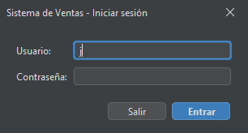
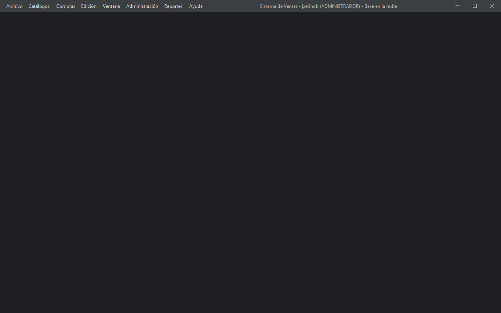
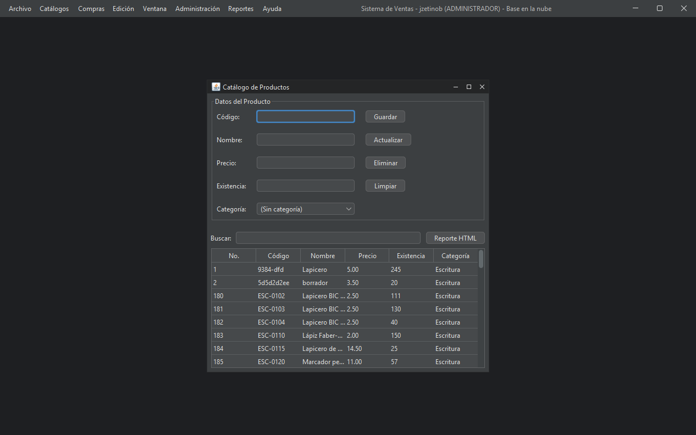
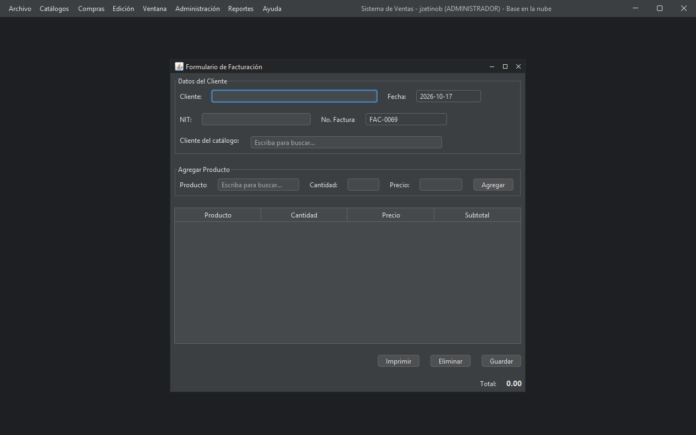
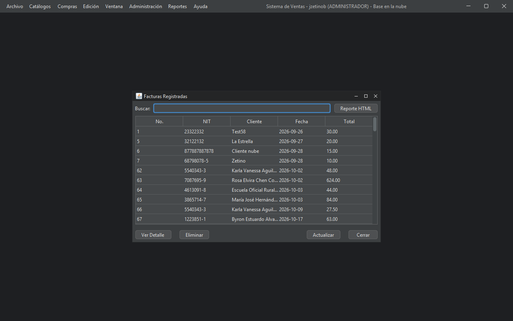
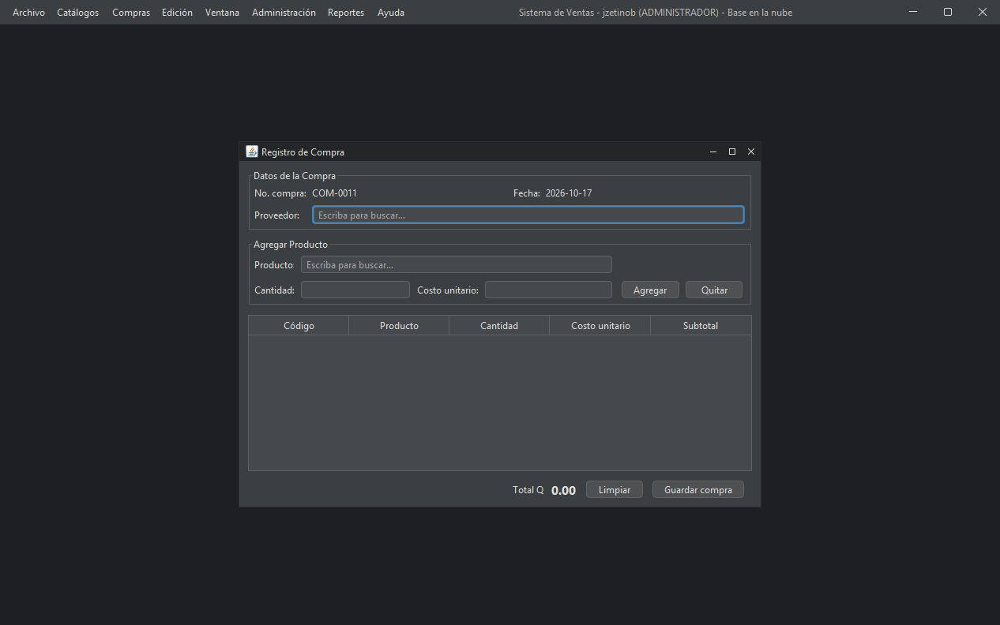
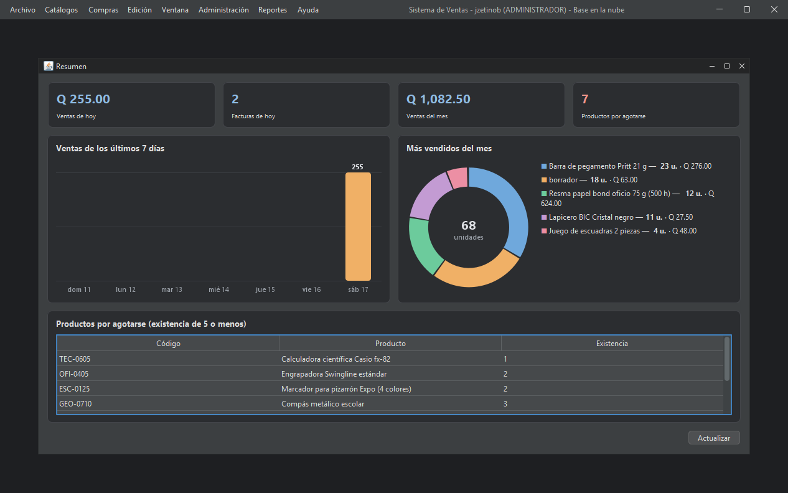
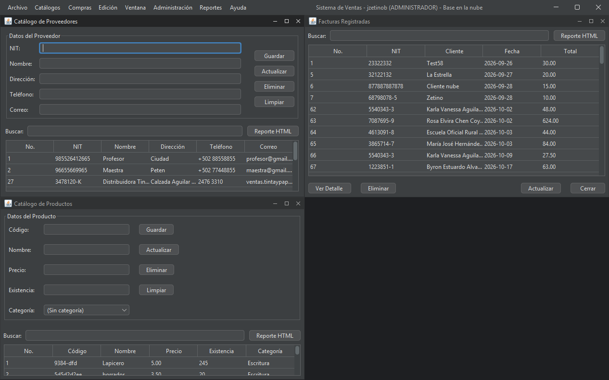

# Revisión presencial: cumplimiento de la Guía Didáctica

**Curso:** Programación II · Universidad Mariano Gálvez
**Proyecto:** Sistema de Ventas (facturación e inventario)
**Repositorio:** https://github.com/jzetinob/sistema-ventas

En la revisión presencial se repasó la **Guía Didáctica del curso** ([`Guia-Didactica-Programacion-II.pdf`](Guia-Didactica-Programacion-II.pdf)): los requisitos del proyecto, sus entregables y los temas de cada unidad. Esta página muestra, punto por punto, cómo los cumple el Sistema de Ventas y dónde está la evidencia.

Las capturas del escritorio se tomaron el 17 de octubre de 2026 con la aplicación real conectada a la base de datos en la nube (Supabase). Las capturas de la app móvil (emulador de Android Studio) se agregarán en la siguiente actualización.

---

## 1. Requisitos del proyecto

| Requisito de la guía | Cómo lo cumple el proyecto | Evidencia |
|---|---|---|
| **Diseño modular**, agrupado por funcionalidades (clientes, proveedores, empleados, factura-detalle…) | Código en paquetes `modelo`, `dao`, `controlador` y `vista` (MVC). El menú agrupa los módulos: facturación, catálogos, compras, reportes y administración | [02](#escritorio), [08](#escritorio) |
| **Altas, bajas y cambios** en cada módulo | Botones *Guardar*, *Actualizar* y *Eliminar* en los 6 catálogos (productos, clientes, empleados, categorías, proveedores y usuarios). Las facturas y compras se registran y se pueden eliminar o anular | [03](#escritorio), [08](#escritorio) |
| **Búsquedas** en cada módulo | Barra *Buscar* en catálogos y listas, que filtra mientras se escribe. En factura y compra, buscadores de cliente y producto con autocompletado | [03](#escritorio), [04](#escritorio), [05](#escritorio) |
| **Reportes** en HTML, PDF o tablas grid | Botón *Reporte HTML* en cada catálogo y lista (desde el navegador se imprime o se guarda como PDF). Menú *Reportes*: resumen con gráficos, inventario, existencia baja, ventas por período y compras por proveedor. Todas las listas se muestran en tablas | [05](#escritorio), [07](#escritorio) |
| **Al menos 10 entidades** en la base de datos | 11 tablas: `categorias`, `productos`, `clientes`, `telefonos`, `empleados`, `proveedores`, `usuarios`, `facturas`, `factura_detalles`, `compras` y `compra_detalles`. Además, `sesiones_app` para la app móvil | [`esquema-postgresql.sql`](../../sistema-ventas/src/main/resources/bd/esquema-postgresql.sql) |
| **Aplicación móvil** | App Android en Java que usa la misma base de datos que el escritorio | [`movil/`](../../movil/), [`VentasMovil.apk`](../../entregables/VentasMovil.apk) |
| Desarrollado en **Java** | Escritorio en Java 25 (Swing, Maven, NetBeans). Móvil en Java (Android Studio) | [`sistema-ventas/`](../../sistema-ventas/), [`movil/`](../../movil/) |
| **Manuales** de usuario y técnico | Ambos en PDF | [`manual-usuario.pdf`](../../entregables/manual-usuario.pdf), [`manual-tecnico.pdf`](../../entregables/manual-tecnico.pdf) |
| **Código fuente** | Repositorio en GitHub con el historial de cambios | https://github.com/jzetinob/sistema-ventas |
| **Backup** de la base de datos | *Administración → Respaldar base de datos* genera una copia completa en un archivo `.db` | [02](#escritorio) (menú *Administración*) |

## 2. Entregables de la guía

| Entregable | Dónde está |
|---|---|
| 1. Diagrama de clases UML | [Tarea 05](../05-implementacion-diagrama-clases/), [Tarea 06](<../06-Elaboración del Diagrama de Clases del Proyecto/>) y [`docs/diagramas/diagrama-clases.md`](../../docs/diagramas/diagrama-clases.md) |
| 2. Aplicación con listas de objetos y reportes | Los DAO de archivos (`ClienteDAOCsv`, `ProductoDAOCsv`, `FacturaDAOCsv`) guardan listas de objetos (`List<…>`); siguen en el código como referencia |
| 3. Aplicación con base de datos, reportes, diagrama entidad-relación y patrones de diseño | DAO con JDBC, [`diagrama-entidad-relacion.md`](../../docs/diagramas/diagrama-entidad-relacion.md) y patrones (sección 3) |
| Final: app móvil conectada a la base de datos | [`movil/`](../../movil/) y [`entregables/VentasMovil.apk`](../../entregables/VentasMovil.apk) |

## 3. Temas del curso aplicados en el proyecto

| Unidad / tema | Dónde se aplica |
|---|---|
| **POO**: clases, objetos, atributos, métodos, encapsulamiento | Entidades del paquete `modelo` con atributos `private` y sus `get`/`set` |
| **Herencia** | `Cliente`, `Empleado` y `Proveedor` heredan de `Persona` |
| **Composición** | `Factura` ◆ `FacturaDetalle`, `Compra` ◆ `CompraDetalle` y `Cliente` ◆ `Telefono`: los detalles se borran con su dueño (`ON DELETE CASCADE`) |
| **Agregación / asociación** | `Producto` → `Categoria`: si se borra la categoría, el producto sigue existiendo sin categoría (`ON DELETE SET NULL`) |
| **Clases abstractas** | `Persona` y `FrmCatalogo` (base de los formularios de catálogo) |
| **Polimorfismo** | `mostrarInformacion()` se sobrescribe en `Empleado` y `Proveedor`. Sobrecarga: los constructores de `Telefono` |
| **Manejo de excepciones** (`try-catch`) | Los DAO capturan `SQLException` y hacen `rollback` en las transacciones. La app móvil define su propia excepción, `ApiException` |
| **Listas de objetos** | `List<Cliente>`, `List<Producto>`… en DAO, controladores y vistas |
| **Traslado de información entre formularios** | La lista de facturas abre `FrmDetalleFactura` con la factura elegida, y desde ahí `FrmVistaPreviaFactura` |
| **Swing / formularios** | Ventana principal MDI (`JDesktopPane`) con ventanas internas (`JInternalFrame`) |
| **Modelo entidad-relación, SQL, PK y FK** | Script [`esquema-postgresql.sql`](../../sistema-ventas/src/main/resources/bd/esquema-postgresql.sql): 11 tablas con llave primaria, llaves únicas y llaves foráneas con su regla de borrado |
| **Conexión a la base desde Java** (insert, update, delete, select) | Clases `…DAOSQLite` con JDBC y `PreparedStatement`. `ConexionBD` elige entre PostgreSQL (nube) y SQLite (local) |
| **Código seguro**: validaciones, inyección SQL, autenticación | Validaciones en formularios y controladores; consultas parametrizadas (`?`); contraseñas con bcrypt; roles; cierre tras 3 intentos fallidos; RLS en la nube y token de sesión en el móvil |
| **Patrones de diseño** | **MVC** (estructura), **Singleton** (DAO, `ConexionBD`, `Sesion`), **Facade** (`ApiSupabase` en el móvil), **Observer** (los *listeners* de Swing y `Tema.alCambiar`, que avisa a las ventanas cuando cambia el tema), **DAO** y **Template Method** (`FrmCatalogo`). El patrón Decorator no se usó |
| **Desarrollo móvil** con Android Studio y emulador | Proyecto [`movil/`](../../movil/) en Android Studio (Gradle); el APK se genera desde *Build → Generate APKs* |
| **Integración del móvil con la base de datos** | La app llama funciones de la base (`app_login`, `app_productos`, `app_registrar_factura`…) que validan el token de sesión |

## 4. Evidencia

### Escritorio

| | |
|---|---|
| **01. Inicio de sesión** con usuario y contraseña |  |
| **02. Ventana principal MDI**. La barra de título muestra el usuario, su rol y que está conectado a la base en la nube |  |
| **03. Catálogo de productos**: altas, bajas, cambios, búsqueda y *Reporte HTML* |  |
| **04. Factura**: número automático y buscadores de cliente y producto |  |
| **05. Facturas registradas**: búsqueda, detalle y reporte |  |
| **06. Compra a proveedor**: suma existencia al guardar |  |
| **07. Resumen con gráficos**: indicadores, barras de 7 días, dona de más vendidos y productos por agotarse |  |
| **08. MDI con varias ventanas** en mosaico (*Ventana → Mosaico*) |  |

### Móvil

*Pendiente:* capturas de la app en el emulador de Android Studio (inicio de sesión, menú, productos, clientes, ventas por fecha, resumen y nueva venta).
