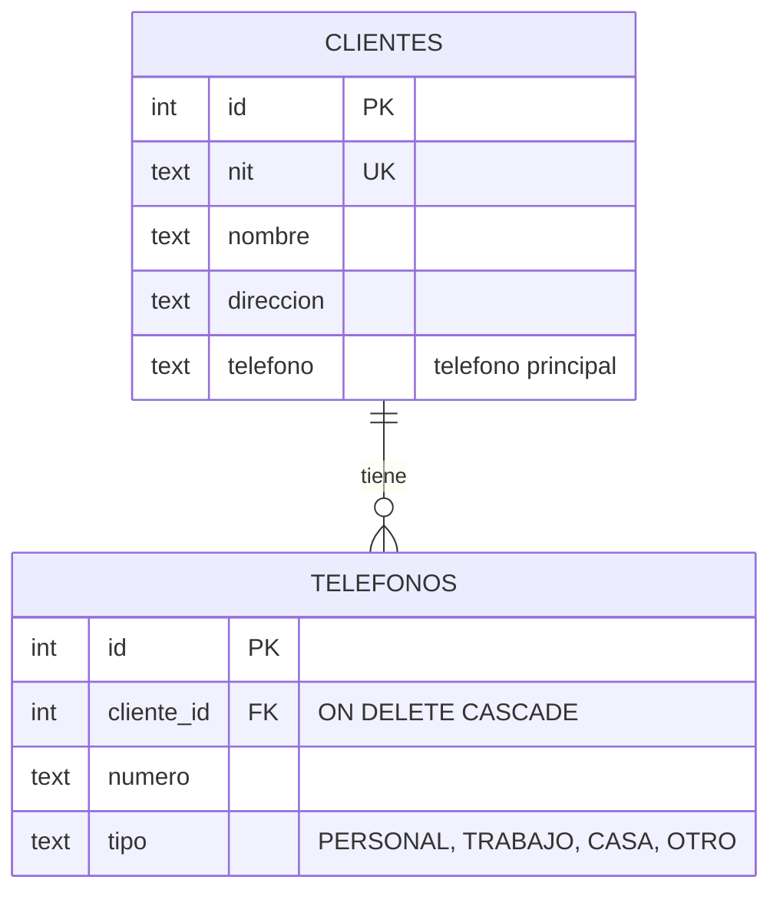
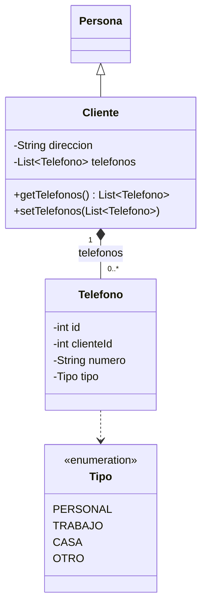
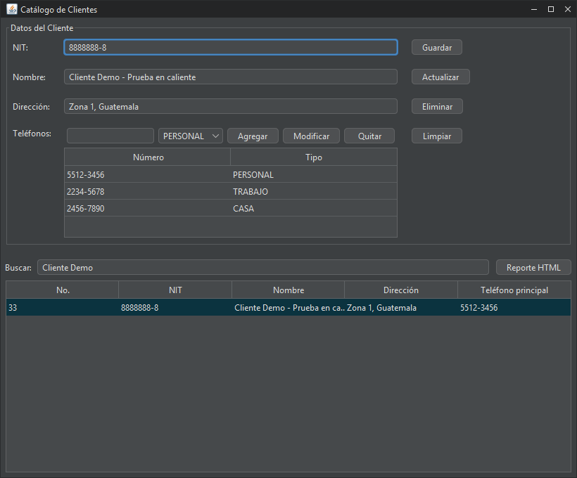
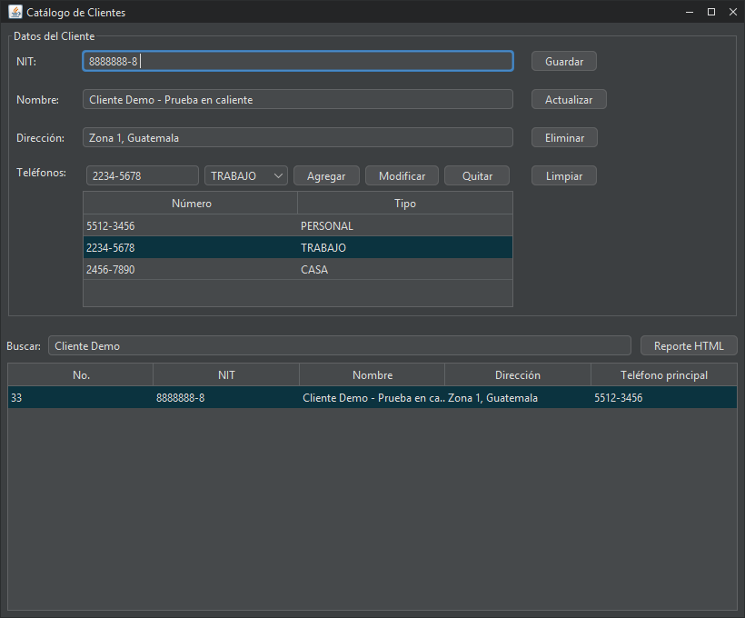

# Prueba práctica en clase: Cambio en caliente

**Curso:** Programación II · Universidad Mariano Gálvez
**Proyecto:** Sistema de Ventas (facturación e inventario)
**Repositorio:** https://github.com/jzetinob/sistema-ventas

**Requerimiento:** un cliente puede registrar **uno o varios teléfonos**, sin una cantidad fija. De cada teléfono se guarda el **número** y el **tipo** (Personal, Trabajo, Casa u Otro). No se permiten campos fijos `telefono1`, `telefono2`, `telefono3`: los teléfonos son una **colección relacionada con el cliente**.

El cambio se hizo sobre la aplicación existente, respetando su arquitectura (MVC + DAO), con apoyo de un agente de IA (Claude Code), como pide la prueba.

---

## 1. Modelo y relación Cliente–Teléfonos (1.0)

Cada teléfono es **una fila** de la tabla nueva `telefonos`, que apunta a su cliente con la llave foránea `cliente_id`. Así un cliente puede tener todos los teléfonos que necesite.



En Java, `Cliente` tiene una **lista** de objetos `Telefono` (relación 1 a muchos):



- `Telefono.Tipo` es un `enum`, igual que `Usuario.Rol`: solo existen los 4 tipos válidos. La base de datos repite la regla con un `CHECK`.
- La columna `clientes.telefono` se conserva como **teléfono principal** (el primero de la lista), para que la app Android y los reportes sigan funcionando sin cambios.
- **Migración:** el teléfono que ya tenía cada cliente se pasó a la tabla nueva como tipo `PERSONAL`, así no se perdió ningún dato.

## 2. Persistencia / DAO (1.0)

| Archivo | Qué hace |
|---|---|
| `bd/esquema-postgresql.sql` | Crea `telefonos` en Supabase (llave foránea con `ON DELETE CASCADE`, `CHECK` del tipo, índice por cliente, RLS activo como el resto de tablas) y migra los teléfonos existentes |
| `dao/ConexionBD.java` | Crea la misma tabla en SQLite (modo local) |
| `dao/CopiadorBD.java` | El respaldo de la base incluye la tabla `telefonos` |
| `dao/TelefonoDAO.java` (**nuevo**) | Interfaz con `listarPorCliente(clienteId)` y `reemplazar(clienteId, telefonos)` |
| `dao/TelefonoDAOSQLite.java` (**nuevo**) | Implementación JDBC y **Singleton**, igual que los demás DAO |

`reemplazar` guarda la lista actual de teléfonos **en una transacción**: borra los que tenía el cliente y vuelve a insertar los de la lista. Si algo falla, hace `rollback` y no queda nada a medias. Es la misma estrategia que ya usaba `FacturaDAOSQLite.actualizar` con los detalles de la factura. Todas las consultas usan `PreparedStatement` con parámetros (`?`), sin riesgo de inyección SQL.

## 3. Servicio / lógica (1.0)

El proyecto sigue el patrón MVC: la lógica de negocio vive en el **controlador**, que cumple el papel de servicio. En `controlador/ClienteController.java`:

| Método | Lógica |
|---|---|
| `Guardar(cliente)` | Valida los teléfonos, deja el primero como teléfono principal, guarda el cliente (`ClienteDAO`) y luego sus teléfonos (`TelefonoDAO`). Devuelve `null` si todo salió bien o el mensaje de error, igual que `UsuarioController.Crear` |
| `Actualizar(cliente)` | Las mismas reglas, para modificar un cliente existente y su lista de teléfonos |
| `GetTelefonos(clienteId)` | Consulta los teléfonos guardados de un cliente |
| `validarTelefonos(...)` | Reglas: cada número con 8 a 15 dígitos (se permiten `+`, guiones y espacios), con tipo y **sin repetirse** |

## 4. Controlador + Vista (1.0)

| Archivo | Qué hace |
|---|---|
| `vista/PanelTelefonos.java` (**nuevo**) | Componente reutilizable: número + tipo + botones **Agregar**, **Modificar** y **Quitar**, y una tabla con los teléfonos. Trabaja con una lista en memoria hasta que el cliente se guarda |
| `vista/FrmClientes.java` | Reemplaza la caja de un solo teléfono por `PanelTelefonos`. Al seleccionar un cliente carga sus teléfonos desde la base. *Guardar* y *Actualizar* envían la lista al controlador y muestran sus mensajes. La columna de la tabla ahora se llama *Teléfono principal* |

## 5. Recorrido de la información

```
Vista                        Controlador / Servicio            DAO                                 Base de datos
PanelTelefonos (lista)  →    ClienteController.Guardar   →     ClienteDAOSQLite.guardar      →     INSERT INTO clientes  (devuelve el id)
FrmClientes.guardarCliente     · validarTelefonos              TelefonoDAOSQLite.reemplazar  →     DELETE + INSERT INTO telefonos
                               · telefono principal              (en una transacción)                (cliente_id = id del cliente)
```

**Consultar:** al seleccionar un cliente → `FrmClientes.cargarSeleccionado` → `ClienteController.GetTelefonos(id)` → `TelefonoDAOSQLite.listarPorCliente(id)` → `SELECT ... FROM telefonos WHERE cliente_id = ?` → el panel muestra la lista.

## 6. Evidencia

**Cliente con tres teléfonos.** Se registró con dos teléfonos y luego se actualizó para agregarle un tercero. La captura se tomó al **volver a abrir** el formulario, en una ejecución nueva: los teléfonos se leen desde la base de datos en Supabase.



**Modificar.** Al seleccionar un teléfono de la lista, se carga en las cajas para cambiarlo (**Modificar**) o quitarlo (**Quitar**); después, **Actualizar** guarda los cambios.



**Consulta en la base (NetBeans → Services → Execute Command):**

```sql
SELECT c.nombre, t.numero, t.tipo
FROM clientes c
JOIN telefonos t ON t.cliente_id = c.id
WHERE c.nit = '8888888-8'
ORDER BY t.id;
```

| nombre | numero | tipo |
|---|---|---|
| Cliente Demo - Prueba en caliente | 5512-3456 | PERSONAL |
| Cliente Demo - Prueba en caliente | 2234-5678 | TRABAJO |
| Cliente Demo - Prueba en caliente | 2456-7890 | CASA |

Además, se migraron los teléfonos de los **28 clientes** que ya existían, y se comprobó que al eliminar un cliente sus teléfonos se borran en cascada.

## 7. Lista de verificación

- [x] El cliente puede tener más de un teléfono.
- [x] No se utilizaron campos fijos `telefono1`, `telefono2`, `telefono3`.
- [x] Se almacena número y tipo.
- [x] Los datos quedan persistidos (PostgreSQL en Supabase; también funciona con SQLite local).
- [x] Al consultar nuevamente aparecen los teléfonos.
- [x] La vista permite trabajar con múltiples teléfonos (agregar, modificar y quitar).
- [x] Se pueden explicar las clases modificadas y el flujo completo (secciones 2 a 5).

## 8. Archivos nuevos y modificados

| Capa | Nuevos | Modificados |
|---|---|---|
| Modelo | [`Telefono.java`](../../sistema-ventas/src/main/java/com/josue/ventas/modelo/Telefono.java) | [`Cliente.java`](../../sistema-ventas/src/main/java/com/josue/ventas/modelo/Cliente.java) |
| Datos / DAO | [`TelefonoDAO.java`](../../sistema-ventas/src/main/java/com/josue/ventas/dao/TelefonoDAO.java), [`TelefonoDAOSQLite.java`](../../sistema-ventas/src/main/java/com/josue/ventas/dao/TelefonoDAOSQLite.java) | [`ConexionBD.java`](../../sistema-ventas/src/main/java/com/josue/ventas/dao/ConexionBD.java), [`CopiadorBD.java`](../../sistema-ventas/src/main/java/com/josue/ventas/dao/CopiadorBD.java), [`esquema-postgresql.sql`](../../sistema-ventas/src/main/resources/bd/esquema-postgresql.sql) |
| Controlador / Servicio | — | [`ClienteController.java`](../../sistema-ventas/src/main/java/com/josue/ventas/controlador/ClienteController.java) |
| Vista | [`PanelTelefonos.java`](../../sistema-ventas/src/main/java/com/josue/ventas/vista/PanelTelefonos.java) | [`FrmClientes.java`](../../sistema-ventas/src/main/java/com/josue/ventas/vista/FrmClientes.java) |
