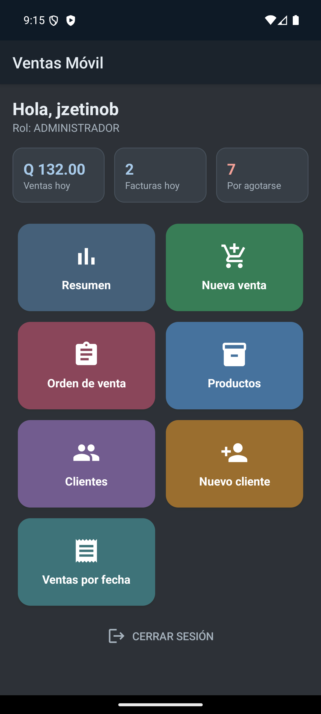
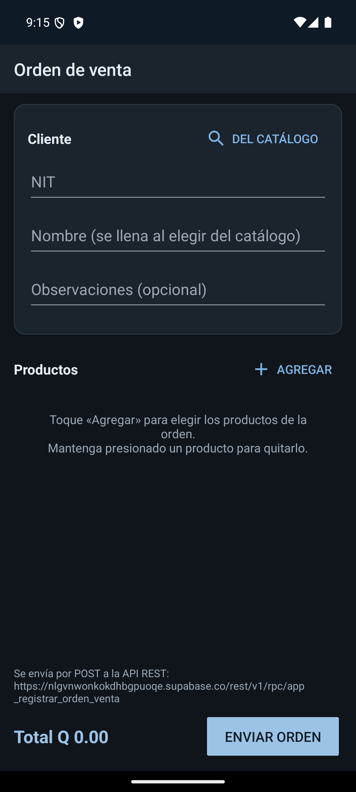
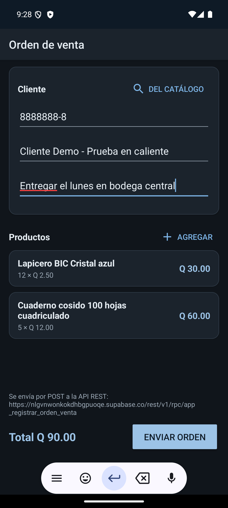
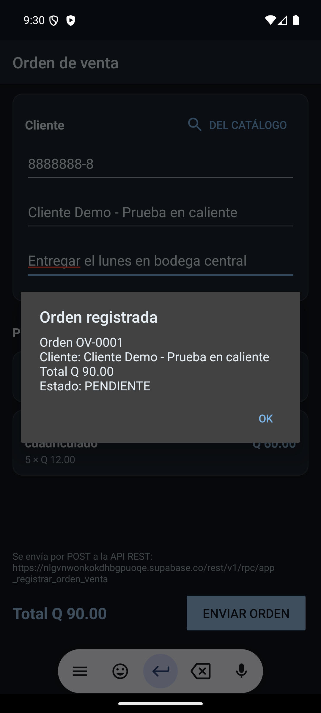
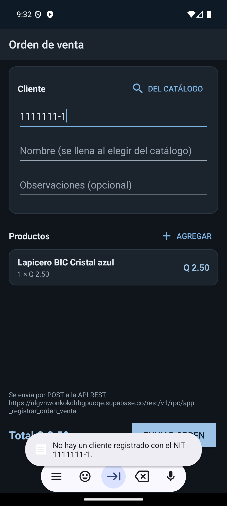
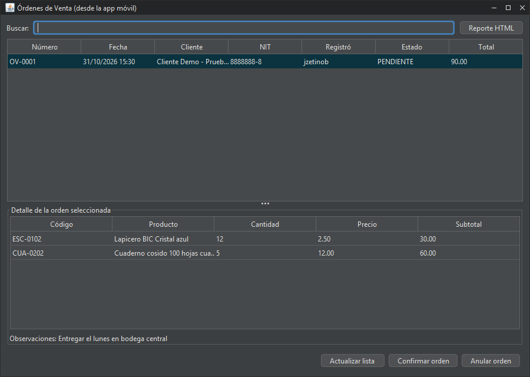
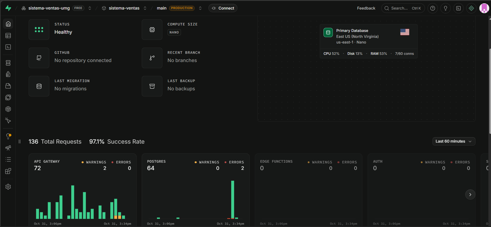
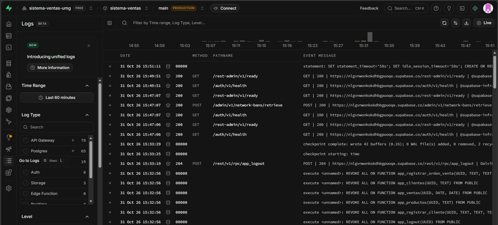

# Tarea final: Integración Android + API REST

**Curso:** Programación II · Universidad Mariano Gálvez
**Proyecto:** Sistema de Ventas (facturación e inventario)
**Valor:** 8 puntos · **Enunciado:** [PDF de la tarea](Tarea-Final-Integracion-Android-API-REST.pdf)

**Requerimiento:** la app Android permite **crear una Orden de Venta**. Al confirmarla, envía una petición **POST** a una **API REST**, que valida los datos, guarda la orden en la base de datos y responde éxito o error; la app le muestra al usuario el resultado.

> **Sobre ngrok:** el enunciado propone ejecutar la API en la computadora y publicarla con ngrok. Este proyecto ya tenía su API REST publicada en **Supabase**, con una URL pública y HTTPS que no cambia entre ejecuciones. El docente aprobó usar Supabase en lugar de ngrok, así que no hace falta levantar un túnel.

---

## 1. Los tres repositorios

Las tres aplicaciones están en un solo repositorio de GitHub, cada una en su carpeta con su propio `README.md`:

| # | Repositorio | Enlace |
|---|---|---|
| 1 | Aplicación de escritorio | https://github.com/jzetinob/sistema-ventas/tree/main/sistema-ventas |
| 2 | API REST | https://github.com/jzetinob/sistema-ventas/tree/main/api |
| 3 | Aplicación Android | https://github.com/jzetinob/sistema-ventas/tree/main/movil |

No se suben contraseñas: la de la base de datos va en `sistema-ventas/config/bd.properties`, que Git ignora. La clave que lleva la app Android es la *publishable* de Supabase, que es pública por diseño y no da acceso a las tablas.

## 2. Flujo Android → API REST → base de datos

```
App Android ──POST HTTPS (JSON)──▶ URL pública de Supabase ──▶ API REST ──▶ función app_registrar_orden_venta ──▶ PostgreSQL
 (NuevaOrdenActivity)              /rest/v1/rpc/...            (PostgREST)    valida y guarda en una transacción     ordenes_venta
      ▲                                                                                                              orden_venta_detalles
      └──────────── 200 {"numero_orden": "OV-0001", ...}  ó  400 / 403 {"message": "..."} ◀───────────────────────────────┘
```

Equivale al flujo del enunciado: *Android → URL pública de ngrok → API REST local → Base de datos → respuesta hacia Android*. La única diferencia es que la URL pública y la API están en Supabase y no en la computadora.

Después, en la **aplicación de escritorio** (*Archivo → Órdenes de Venta*) se ven las órdenes que llegaron desde el teléfono y se pueden **confirmar** o **anular**.

## 3. El endpoint

```
POST https://nlgvnwonkokdhbgpuoqe.supabase.co/rest/v1/rpc/app_registrar_orden_venta
apikey: <clave publishable>
Content-Type: application/json

{
  "p_token": "<token de la sesión>",
  "p_nit": "8888888-8",
  "p_observaciones": "Entregar el lunes en bodega central",
  "p_detalles": [ { "codigo": "ESC-0102", "cantidad": 12 }, { "codigo": "CUA-0202", "cantidad": 5 } ]
}
```

| Respuesta | Cuándo | Cuerpo |
|---|---|---|
| **200 OK** | La orden se guardó | `{"numero_orden": "OV-0001", "cliente": "…", "total": 90.00, "estado": "PENDIENTE"}` |
| **400 Bad Request** | Un dato no es válido | `{"message": "No hay un cliente registrado con el NIT 1111111-1."}` |
| **403 Forbidden** | La sesión no existe o venció | `{"message": "Sesión inválida o vencida. Inicie sesión de nuevo."}` |

**Validaciones de la API** (si falla una, no se guarda nada): sesión válida, cliente existente, al menos un producto, sin productos repetidos, cantidades de 1 a 100 000, productos del catálogo y observaciones de hasta 500 caracteres. El precio lo pone la base desde el catálogo; el teléfono no lo envía.

Detalle completo, seguridad y cómo probarla: [`api/README.md`](../../api/README.md).

## 4. Código principal

**Android: construir y enviar la petición** ([`ApiSupabase.java`](../../movil/app/src/main/java/com/josue/ventas/movil/datos/ApiSupabase.java))

```java
conexion = (HttpURLConnection) new URL(ConfigSupabase.URL + "/rest/v1/rpc/" + funcion).openConnection();
conexion.setRequestMethod("POST");
conexion.setRequestProperty("apikey", ConfigSupabase.CLAVE_PUBLICA);
conexion.setRequestProperty("Content-Type", "application/json");
```

`registrarOrdenVenta(...)` arma el JSON (`p_token`, `p_nit`, `p_observaciones` y la lista `p_detalles`) y lo envía en un hilo aparte para no congelar la pantalla. Si la API responde 200 llama a `exito(...)`; si responde 400 o 403 llama a `error(...)` con el mensaje que mandó la API.

**Android: el formulario** ([`NuevaOrdenActivity.java`](../../movil/app/src/main/java/com/josue/ventas/movil/vista/NuevaOrdenActivity.java))

- Cliente del catálogo (o NIT escrito), productos con su cantidad, observaciones y total.
- Muestra en pantalla la URL del endpoint al que hace el POST.
- Valida lo básico antes de enviar (NIT y al menos un producto) y pide confirmación.
- Respuesta de éxito: diálogo *Orden registrada* con número, cliente, total y estado. Respuesta de error: mensaje de la API.

**API REST: recibir, validar y guardar** ([`esquema-postgresql.sql`](../../sistema-ventas/src/main/resources/bd/esquema-postgresql.sql), función `app_registrar_orden_venta`)

1. Valida el token de sesión (si falla: 403).
2. Busca el cliente por NIT y revisa observaciones, productos y cantidades (si falla: 400 con el motivo).
3. Bloquea la tabla para dar el siguiente número (`OV-0001`, `OV-0002`, …) sin repetirlo.
4. Inserta la orden y sus detalles con el precio del catálogo y calcula el total.
5. Devuelve el JSON con número, cliente, total y estado.

**Escritorio: consultar y procesar las órdenes** ([`FrmOrdenesVenta.java`](../../sistema-ventas/src/main/java/com/josue/ventas/vista/FrmOrdenesVenta.java) → [`OrdenVentaController.java`](../../sistema-ventas/src/main/java/com/josue/ventas/controlador/OrdenVentaController.java) → [`OrdenVentaDAOSQLite.java`](../../sistema-ventas/src/main/java/com/josue/ventas/dao/OrdenVentaDAOSQLite.java)), con la misma arquitectura MVC + DAO del resto del proyecto.

## 5. Evidencia

Prueba real del 31 de octubre de 2026, desde el emulador Android (Pixel 7, API 36) contra la base en Supabase.

**1) Menú con la opción nueva y 2) formulario vacío con la URL del endpoint**

<p>


</p>

**3) Orden lista para enviar y 4) respuesta de éxito de la API**

Cliente *Cliente Demo*, 12 lapiceros a Q2.50 y 5 cuadernos a Q12.00, total Q90.00. La API respondió con la orden **OV-0001** en estado **PENDIENTE**.

<p>


</p>

**5) Respuesta de error de la API**

Con un NIT que no existe (`1111111-1`), la API rechazó la orden (HTTP 400), no guardó nada, y la app mostró su mensaje.

<p>

</p>

**6) La orden en la aplicación de escritorio** (*Archivo → Órdenes de Venta*)



**7) La orden en la base de datos**

```sql
SELECT o.numero_orden, o.fecha, c.nombre, u.usuario, o.estado, o.observaciones, o.total,
       (SELECT count(*) FROM orden_venta_detalles d WHERE d.orden_venta_id = o.id) AS productos
FROM ordenes_venta o
JOIN clientes c ON c.id = o.cliente_id
LEFT JOIN usuarios u ON u.id = o.usuario_id
ORDER BY o.id DESC;
```

| numero_orden | fecha | nombre | usuario | estado | observaciones | total | productos |
|---|---|---|---|---|---|---|---|
| OV-0001 | 2026-10-31 15:30:15 | Cliente Demo - Prueba en caliente | jzetinob | PENDIENTE | Entregar el lunes en bodega central | 90.00 | 2 |

La orden con el NIT inexistente no aparece: la API la rechazó antes de guardar.

**8) La API en el panel de Supabase**

Panel del proyecto `sistema-ventas`: base de datos en línea (*Healthy*) y las peticiones que recibió la API en la última hora.



Registros (*Logs*) del mismo día, en hora de Guatemala:

- Entre las 15:30 y las 15:32 se ve la actividad de la prueba: la orden enviada y los intentos con el NIT inexistente (la barra roja corresponde a las peticiones rechazadas).
- A las 15:33:19 llega el `POST /rest/v1/rpc/app_logout` con respuesta **204**. Es el cierre de sesión hecho desde la app, que se identifica como `Dalvik`, la máquina virtual de Android.
- A las 15:32:56 la base ejecuta el script de la API al abrir la app de escritorio: crea o actualiza funciones como `app_registrar_orden_venta` y les quita el permiso al rol público (`REVOKE ALL ... FROM PUBLIC`).



## 6. Lista de verificación

Requerimiento principal (sección 2 del enunciado):

- [x] Ingreso de los datos de la orden desde Android (capturas 2 y 3).
- [x] Envío de los datos mediante una petición POST (sección 4).
- [x] Recepción de la petición en la API REST (función `app_registrar_orden_venta`).
- [x] Validación básica de los datos recibidos (sección 3; captura 5).
- [x] Registro de la Orden de Venta en la base de datos (evidencia 6 y 7).
- [x] Respuesta de éxito o error desde la API (200, 400 y 403).
- [x] Mensaje en Android con el resultado (capturas 4 y 5).

Demostración (sección 5 del enunciado):

- [x] Ejecutar la API REST: está publicada en Supabase, siempre en línea.
- [x] Mostrar el endpoint: aparece en la pantalla de la orden y en [`api/README.md`](../../api/README.md).
- [x] Túnel público: en lugar de ngrok, la URL pública HTTPS de Supabase (aprobado por el docente).
- [x] Mostrar la URL que usa la app: [`ConfigSupabase.java`](../../movil/app/src/main/java/com/josue/ventas/movil/datos/ConfigSupabase.java) y la pantalla de la orden.
- [x] Crear una Orden de Venta desde Android.
- [x] Comprobar que llegó a la API: la API respondió con el número de orden, y los registros de Supabase muestran las peticiones (evidencia 8).
- [x] Comprobar que quedó en la base: ventana del escritorio o la consulta SQL.
- [x] Explicar cómo se comunican Android, la API REST y la base de datos (secciones 2 a 4).

## 7. Guion para la demostración

1. **Antes de la clase:** abrir la app de escritorio un día antes, porque Supabase Free se pausa tras 7 días sin uso. Instalar en el teléfono el APK actualizado [`entregables/VentasMovil.apk`](../../entregables/VentasMovil.apk). Si el teléfono tiene la versión anterior, **desinstalarla primero**, porque el APK nuevo está firmado en otra computadora y Android no deja actualizarlo encima.
2. **Mostrar la API:** abrir [`api/README.md`](../../api/README.md) y explicar el endpoint y sus respuestas (sección 3).
3. **Mostrar la URL en Android:** abrir *Orden de venta*; abajo aparece la URL a la que se envía el POST.
4. **Crear la orden:** *Del catálogo* → elegir cliente → *Agregar* productos → *Enviar orden* → aparece *Orden registrada* con su número.
5. **Mostrar un error:** escribir un NIT que no existe y enviar; la API responde con el motivo.
6. **Comprobar en la base:** en el escritorio, *Archivo → Órdenes de Venta* → *Actualizar lista*; seleccionar la orden para ver sus productos. Luego *Confirmar orden*.
7. **Explicar el flujo** con el diagrama de la sección 2 y el código de la sección 4.

## 8. Seguimiento después de la entrega

- **2026-11-06, teléfono real:** se instaló el APK actual ([`entregables/VentasMovil.apk`](../../entregables/VentasMovil.apk)) en un teléfono Android y la app funciona contra la misma API REST. La base registró el inicio de sesión desde el teléfono a las 23:22.
- **Supabase activo:** el plan gratuito pausa el proyecto si pasa 7 días sin actividad, y mientras tanto la API no responde. Por eso el proyecto se usa al menos una vez por semana; el registro de fechas está en [`docs/proyecto/estado.md`](../../docs/proyecto/estado.md#supabase-activo-plan-free). Si al revisar aparece pausado, se reactiva en supabase.com con *Restore project*, sin perder datos.

## 9. Archivos nuevos y modificados

| Parte | Nuevos | Modificados |
|---|---|---|
| API REST / base de datos | [`api/README.md`](../../api/README.md), [`api/probar-orden-venta.ps1`](../../api/probar-orden-venta.ps1) | [`esquema-postgresql.sql`](../../sistema-ventas/src/main/resources/bd/esquema-postgresql.sql) (tablas `ordenes_venta` y `orden_venta_detalles`, función `app_registrar_orden_venta`) |
| Android | [`NuevaOrdenActivity.java`](../../movil/app/src/main/java/com/josue/ventas/movil/vista/NuevaOrdenActivity.java), `activity_nueva_orden.xml`, `ic_orden_venta.xml` | [`ApiSupabase.java`](../../movil/app/src/main/java/com/josue/ventas/movil/datos/ApiSupabase.java), [`MenuActivity.java`](../../movil/app/src/main/java/com/josue/ventas/movil/vista/MenuActivity.java), `AndroidManifest.xml`, `strings.xml`, `colores.xml` |
| Escritorio: modelo | [`OrdenVenta.java`](../../sistema-ventas/src/main/java/com/josue/ventas/modelo/OrdenVenta.java), [`OrdenVentaDetalle.java`](../../sistema-ventas/src/main/java/com/josue/ventas/modelo/OrdenVentaDetalle.java) | — |
| Escritorio: DAO | [`OrdenVentaDAO.java`](../../sistema-ventas/src/main/java/com/josue/ventas/dao/OrdenVentaDAO.java), [`OrdenVentaDAOSQLite.java`](../../sistema-ventas/src/main/java/com/josue/ventas/dao/OrdenVentaDAOSQLite.java) | [`ConexionBD.java`](../../sistema-ventas/src/main/java/com/josue/ventas/dao/ConexionBD.java), [`CopiadorBD.java`](../../sistema-ventas/src/main/java/com/josue/ventas/dao/CopiadorBD.java) |
| Escritorio: controlador | [`OrdenVentaController.java`](../../sistema-ventas/src/main/java/com/josue/ventas/controlador/OrdenVentaController.java) | — |
| Escritorio: vista | [`FrmOrdenesVenta.java`](../../sistema-ventas/src/main/java/com/josue/ventas/vista/FrmOrdenesVenta.java) | [`FrmPrincipal.java`](../../sistema-ventas/src/main/java/com/josue/ventas/vista/FrmPrincipal.java) (menú *Archivo → Órdenes de Venta*) |
| Documentación | — | `README.md`, manuales (MD y PDF), diagramas de clases y entidad-relación, historial y estado |
